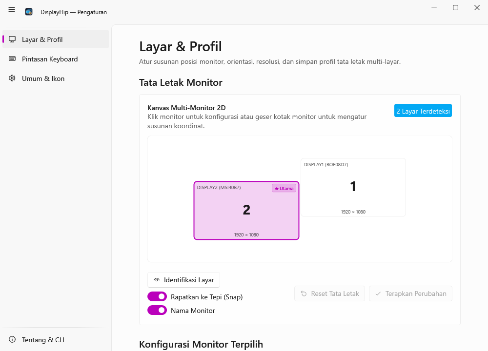
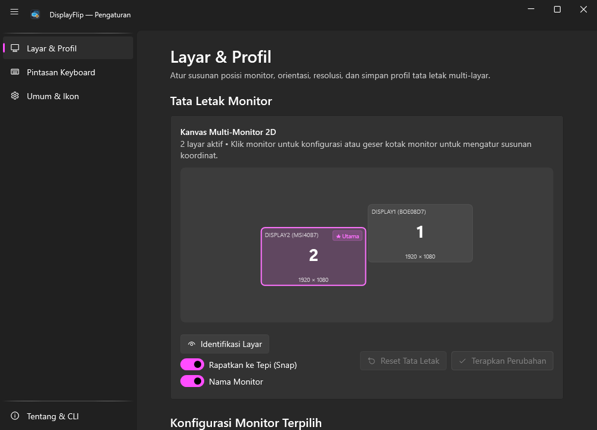
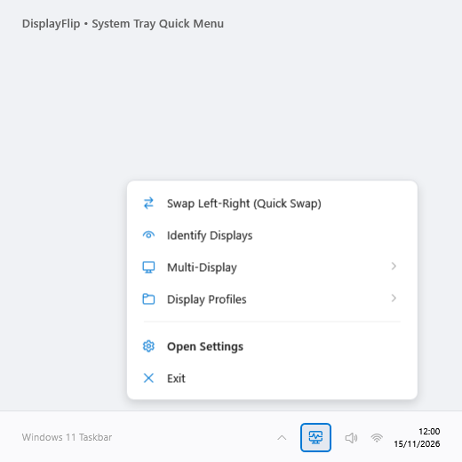
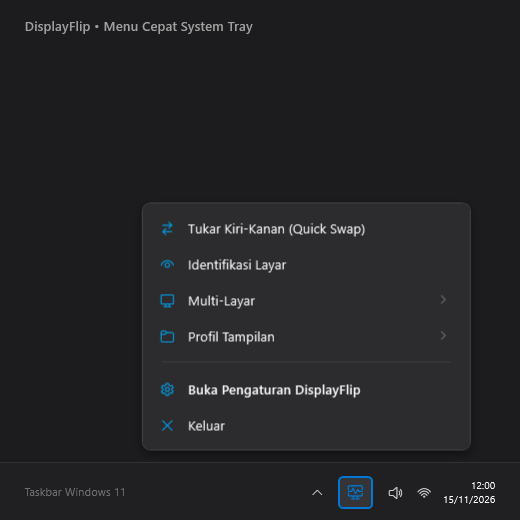
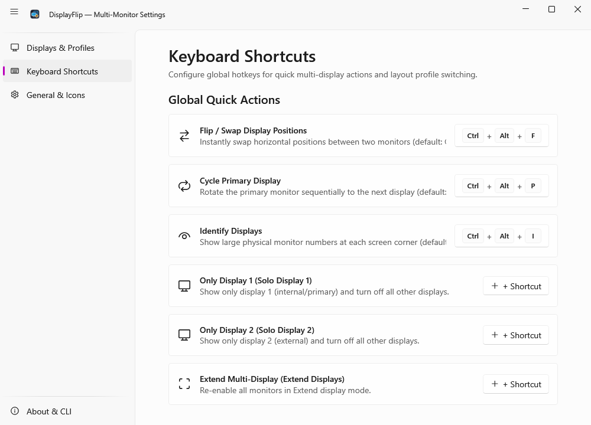
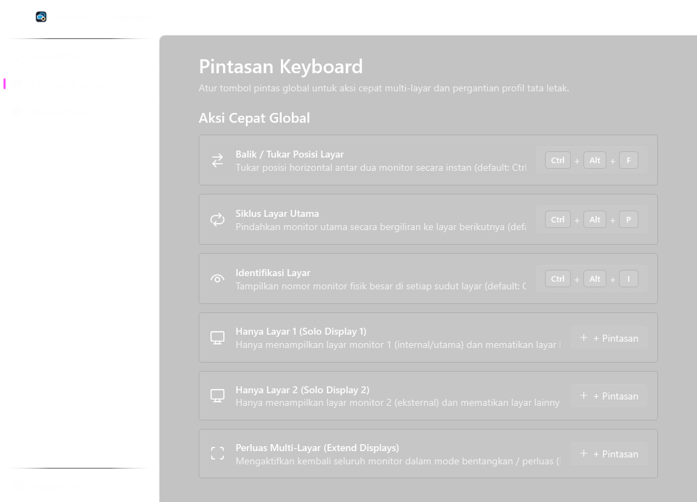
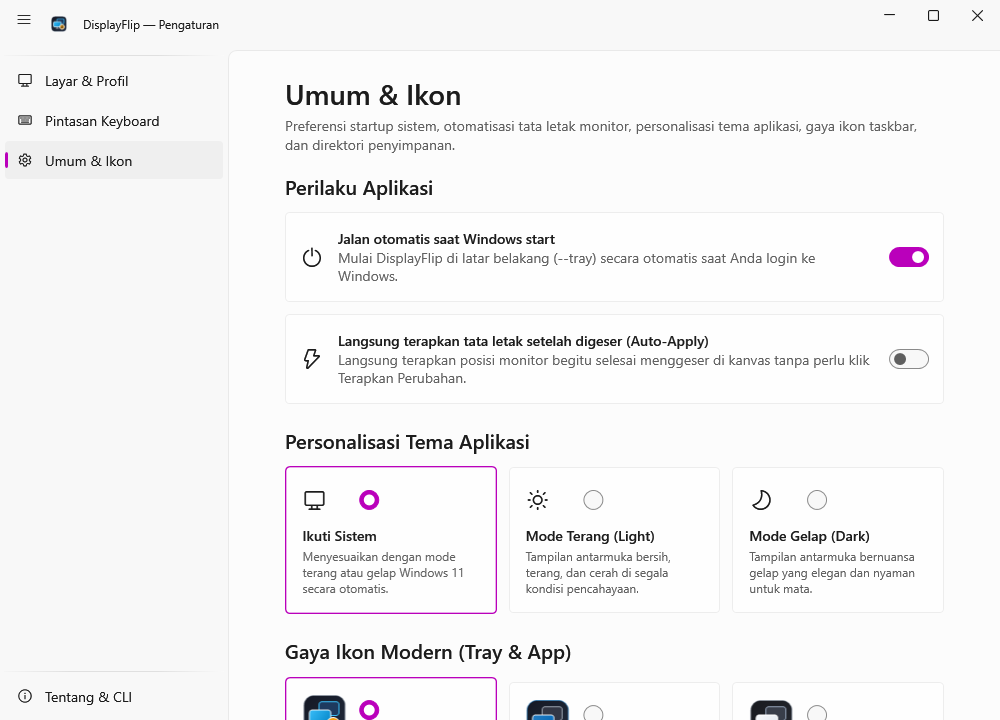
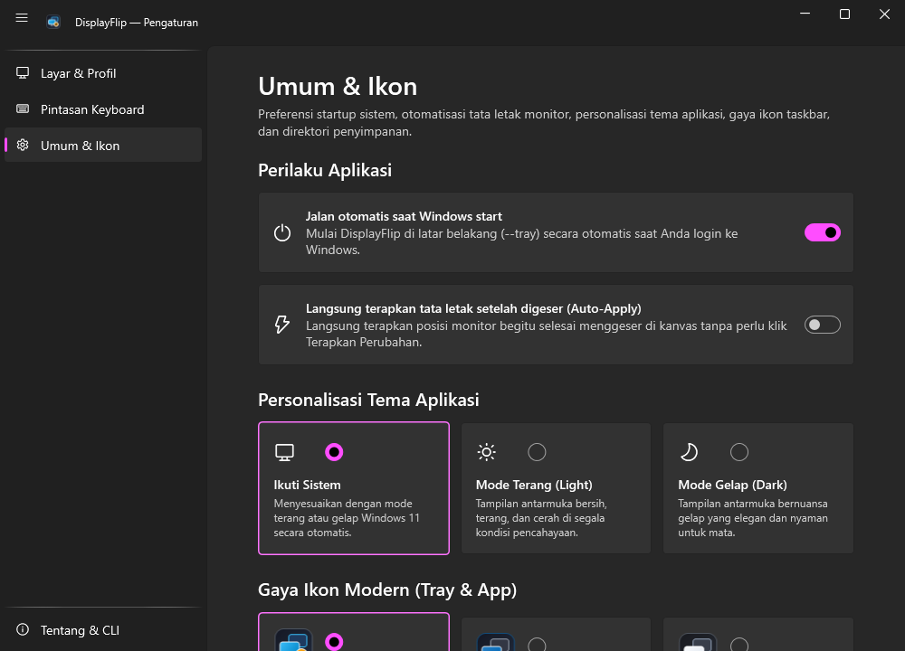
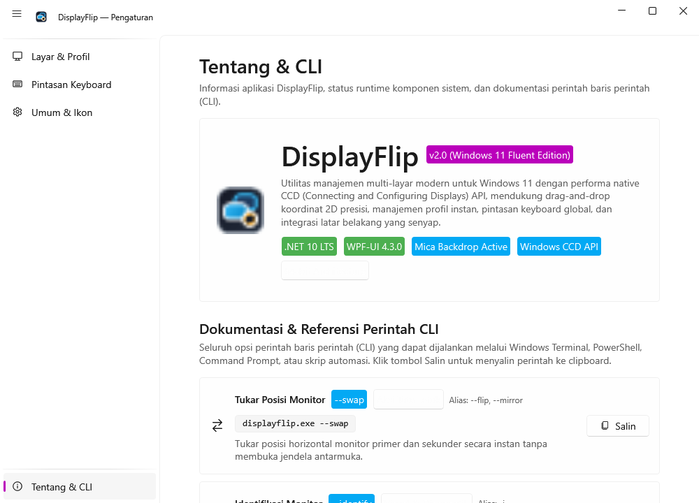
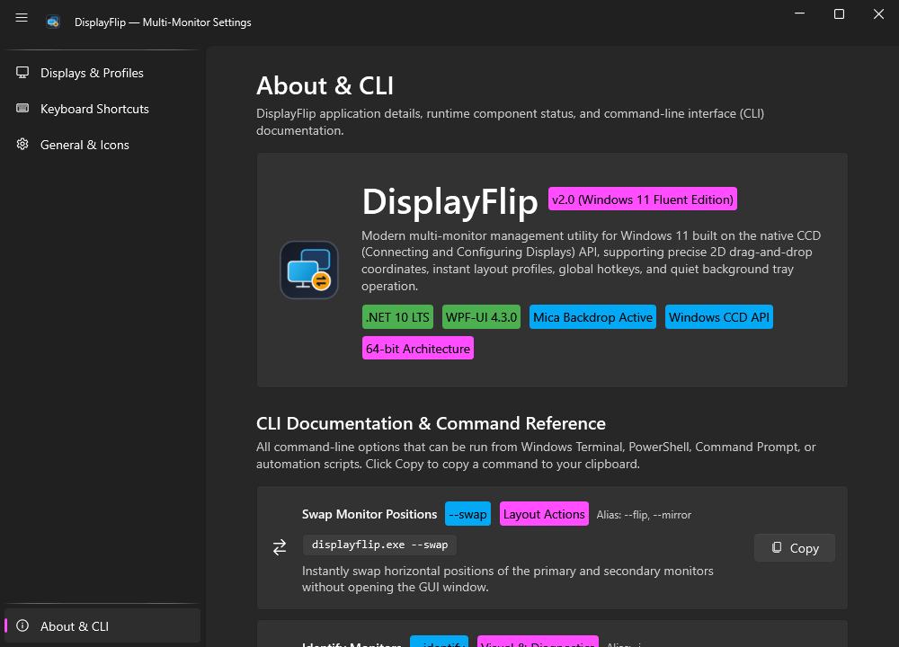

<div align="center">

# DisplayFlip

**Fast, Native Windows 11 Multi-Monitor Layout & Profile Switcher**

[](https://apps.microsoft.com/detail/9npnh94mkjnr)
[](https://github.com/ieproject-app/DisplayFlip/releases/tag/v1.1.0)
[](https://dotnet.microsoft.com/)
[-0078D6?style=for-the-badge&logo=windows)](https://www.microsoft.com/windows)
[](#screenshots)

[Website](https://displayflip.snipgeek.com) • [Microsoft Store](https://apps.microsoft.com/detail/9npnh94mkjnr) • [Download v1.1.0](#download--installation) • [Features](#key-features) • [Screenshots](#screenshots) • [CLI Reference](#cli-reference) • [Build from Source](#build-from-source)

</div>

---

**DisplayFlip** is a lightweight Windows desktop utility built on **.NET 10 LTS** and **Windows 11 Fluent Design (Mica)** that lets you rearrange monitors, swap primary displays, switch projection modes, and apply saved multi-monitor profiles instantly—from an interactive 2D canvas, the System Tray, global keyboard shortcuts, or the command line.

---

## Download & Installation

### 1. Microsoft Store (Recommended)

Install **DisplayFlip** directly from the [**Microsoft Store**](https://apps.microsoft.com/detail/9npnh94mkjnr) (`9NPNH94MKJNR`) for one-click installation, signed MSIX packaging, and automatic background updates on Windows 11 and Windows 10 (x64):

- [**Get DisplayFlip on Microsoft Store →**](https://apps.microsoft.com/detail/9npnh94mkjnr)

### 2. Direct & Portable Downloads (GitHub Release v1.1.0)

For portable use or manual installation without the Microsoft Store, download the release binaries directly below (or view the [**v1.1.0 Release Notes**](https://github.com/ieproject-app/DisplayFlip/releases/tag/v1.1.0)):

| Package / Direct Download | Size | Requirements | Best For |
| :--- | :--- | :--- | :--- |
| [**Microsoft Store (MSIX)**](https://apps.microsoft.com/detail/9npnh94mkjnr) | Managed by Store | Windows 11 / 10 (x64) | **Recommended** for general users (one-click install & automatic updates) |
| [**`DisplayFlip-v1.1.0-win-x64.zip`**](https://github.com/ieproject-app/DisplayFlip/releases/download/v1.1.0/DisplayFlip-v1.1.0-win-x64.zip) | ~3 MB (6.87 MB `.exe`) | [.NET 10 Desktop Runtime](https://dotnet.microsoft.com/en-us/download/dotnet/10.0) | Lightweight portable ZIP for PCs with .NET 10 installed |
| [**`DisplayFlip-v1.1.0-Standalone-win-x64.exe`**](https://github.com/ieproject-app/DisplayFlip/releases/download/v1.1.0/DisplayFlip-v1.1.0-Standalone-win-x64.exe) | ~74 MB | None (Zero dependencies) | **Portable** self-contained single-file `.exe` for any Windows 10/11 x64 PC |

### Quick Start
1. Install from the [**Microsoft Store**](https://apps.microsoft.com/detail/9npnh94mkjnr), or extract/run `DisplayFlip.exe` from the direct download packages above.
2. Right-click the **System Tray** icon for instant actions (**Quick Swap**, **Identify**, **Multi-Display Modes**, **Saved Profiles**).
3. Open **General & Icons** (*Umum & Ikon*) and enable **Run at Windows startup** (*Jalankan saat Windows mulai*) to keep DisplayFlip ready in the background (`--tray`).

---

## Key Features

- **Interactive 2D Monitor Canvas:**
  - Drag and reposition displays with proportional scaling, magnetic edge snapping, and alignment guidelines.
  - Toggleable **Monitor Name** labels (automatically enriched with hardware model IDs like `DISPLAY2 (MSI40B7)`).
  - Per-monitor inspector for **Primary Display**, **Orientation** (Landscape / Portrait / Flipped), **Resolution**, and **Refresh Rate (Hz)**.
- **Smart Profile Switching (Auto-Wake):**
  - Save unlimited monitor arrangements as named profiles.
  - Applying a 2-monitor profile while currently in **Solo** (*PC Screen Only*) or **Duplicate** mode automatically wakes connected displays (`Extend`) before arranging positions and primary roles.
  - If a display is physically unplugged, DisplayFlip safely applies available monitors and reports a clear partial-apply status.
- **System Tray Residency & Quick Actions:**
  - Runs quietly in the Windows notification area; closing (`X`) minimizes to the tray so hotkeys stay active.
  - Fluent context menu with Quick Swap, Identify overlay, Solo 1 / Solo 2 / Extend switching, and instant Profile selection.
- **Global Keyboard Shortcuts:**
  - Interactive key recorder modal with canonical shortcut normalization and automatic conflict resolution across 6 global actions and per-profile hotkeys.
- **Bilingual Interface (Indonesian & English):**
  - Automatically defaults to **Bahasa Indonesia** on Indonesian Windows locales and **English** on all other locales (`Auto`), with live zero-restart switching under **General & Icons** (**Language**).
- **Single-Instance Guard & CLI Automation:**
  - Built-in mutex prevents duplicate background instances and supports scriptable CLI commands (`--swap`, `--apply`, `--solo`, `--extend`, `--list --json`, `--lang <id|en>`).
- **Windows 11 Fluent Design:**
  - Native **Mica** backdrop, Per-Monitor V2 DPI awareness, synchronized **Light / Dark / System** themes, and pixel-crisp multi-resolution vector icons.

---

## Screenshots

| Page | Light Mode | Dark Mode |
| :--- | :---: | :---: |
| **Displays & Profiles**<br>*(2D Canvas, Monitor Labels, Snap & Profiles)* |  |  |
| **System Tray Quick Settings**<br>*(Quick Swap, Modes, Profiles & Identify)* |  |  |
| **Keyboard Shortcuts**<br>*(Global Actions & Per-Profile Hotkeys)* |  |  |
| **General & Icons**<br>*(Auto-Start, Theme & Tray Icon Styles)* |  |  |
| **About & CLI**<br>*(Runtime Info & Interactive CLI Cards)* |  |  |

---

## CLI Reference

DisplayFlip supports direct command-line automation from PowerShell, CMD, or Task Scheduler:

| Command | Alias | Description |
| :--- | :--- | :--- |
| `DisplayFlip.exe --swap` | `--flip`, `--mirror` | Swap horizontal positions of primary and secondary displays |
| `DisplayFlip.exe --identify` | `-i` | Flash on-screen physical monitor identification overlays |
| `DisplayFlip.exe --solo 1` | `--internal` | Switch to Display 1 only |
| `DisplayFlip.exe --solo 2` | `--external` | Switch to Display 2 only |
| `DisplayFlip.exe --extend` | `--perluas` | Extend desktop across all connected displays |
| `DisplayFlip.exe --clone` | `--duplicate` | Duplicate / mirror displays |
| `DisplayFlip.exe --apply "<name>"` | `-p "<name>"` | Apply a saved layout profile (auto-wakes sleeping displays) |
| `DisplayFlip.exe --list [--json]` | — | List all saved profiles (optionally formatted as JSON) |
| `DisplayFlip.exe --lang <id\|en>` | `--lang=id`, `--lang=en` | Override CLI output language for a single command without altering saved settings |
| `DisplayFlip.exe --tray` | `--minimized` | Launch quietly into the System Tray |
| `DisplayFlip.exe --help` | `-h`, `/?` | Print CLI usage help |

---

## Architecture

```text
DisplayFlip.slnx
├── src/
│   ├── DisplayFlip.Core/        # Pure domain models, topology legalization & profile policy (net10.0)
│   ├── DisplayFlip.Windows/     # Win32 CCD (Query/SetDisplayConfig), fallback & startup registry (net10.0-windows)
│   ├── DisplayFlip.Wpf/         # Primary Windows 11 Fluent UI, Tray, Global Hotkeys & CLI (net10.0-windows)
│   ├── DisplayFlip/             # Legacy WinForms UI preserved side-by-side
│   └── DisplayFlip.Tests/       # 316 xUnit tests (topology, profiles, hotkeys, tray, canvas drag, localization & font glyph audit)
├── docs/screenshots/            # Light & Dark UI showcase captures (including System Tray menu)
└── publish.ps1                  # Automated single-file release build script
```

---

## Build from Source

**Prerequisites:** [.NET 10 SDK](https://dotnet.microsoft.com/en-us/download/dotnet/10.0) on Windows 10/11 (x64).

```powershell
# 1. Clone the repository
git clone https://github.com/ieproject-app/DisplayFlip.git
cd DisplayFlip

# 2. Run the full test suite (316 tests)
dotnet test DisplayFlip.slnx

# 3. Run the WPF app directly
dotnet run --project src\DisplayFlip.Wpf\DisplayFlip.Wpf.csproj

# 4. Publish single-file executables
.\publish.ps1                 # Framework-dependent (~6.8 MB) -> artifacts\DisplayFlip\DisplayFlip.exe
.\publish.ps1 -Mode Standalone # Self-contained (~74 MB)       -> artifacts\DisplayFlip-Standalone\DisplayFlip.exe
.\publish.ps1 -Mode All -Clean # Build both variants cleanly
```

---

## License

Released under the [MIT License](LICENSE).

Copyright © 2026 Iwan Efendi.
